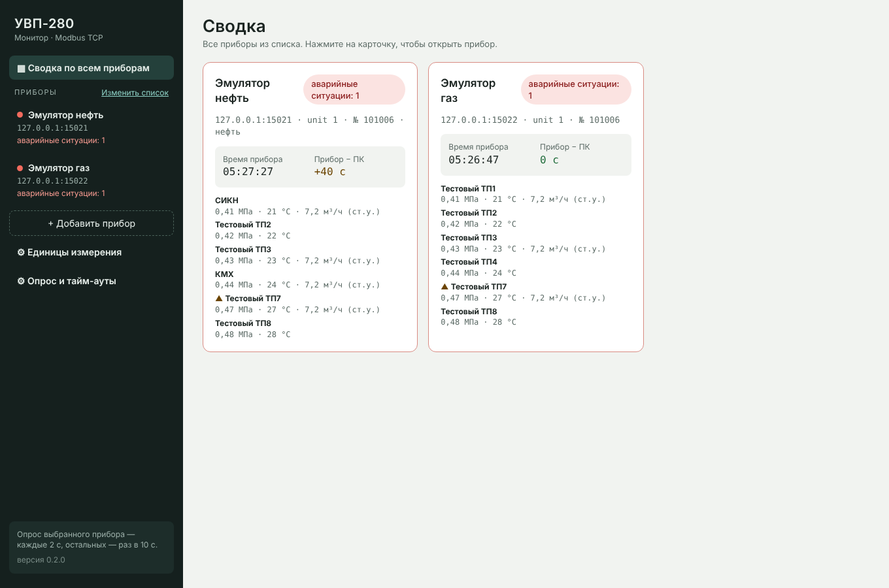
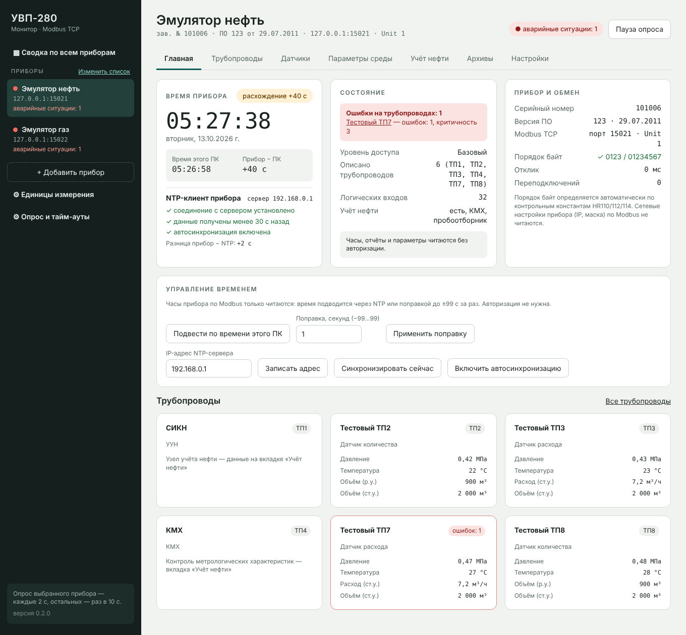
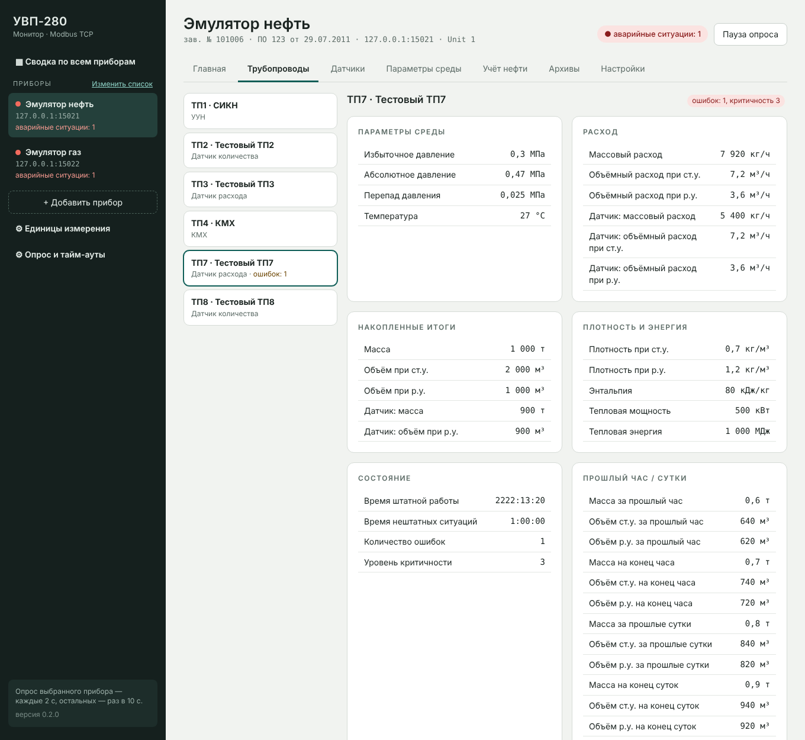
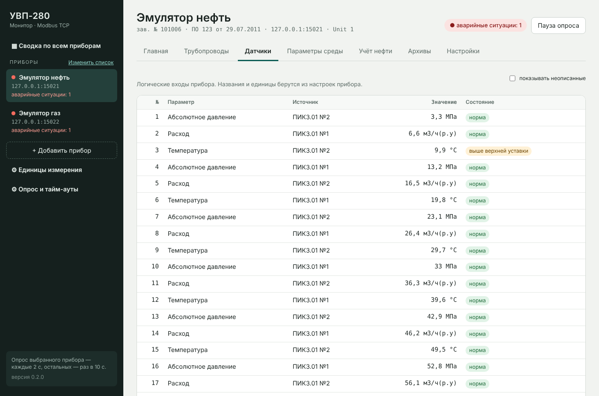
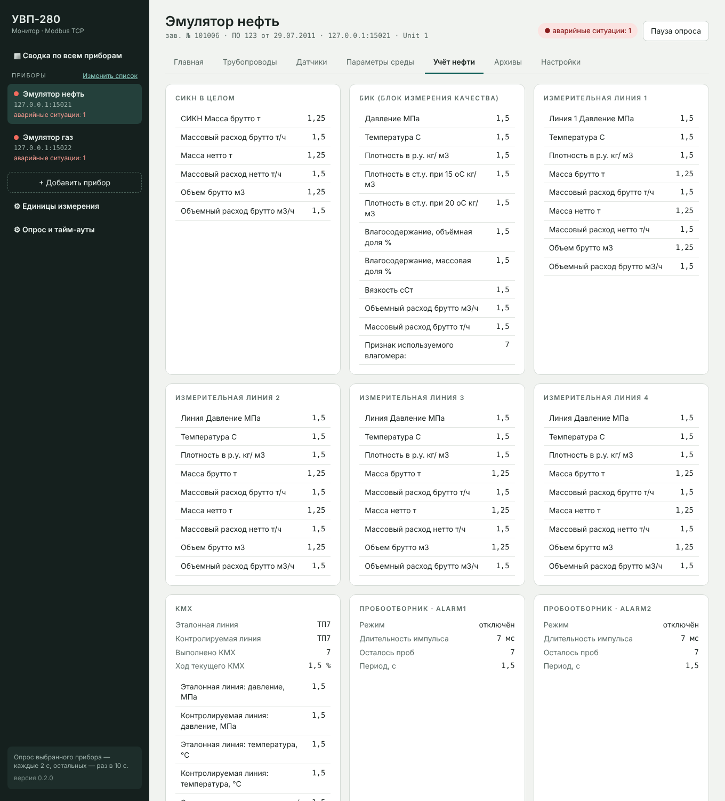
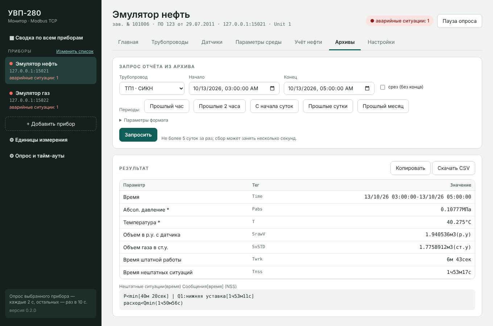
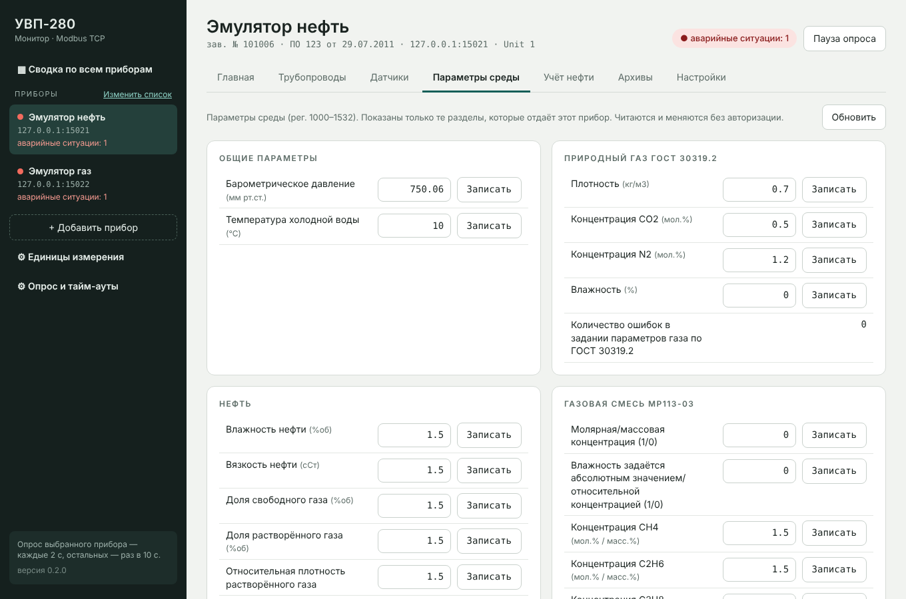
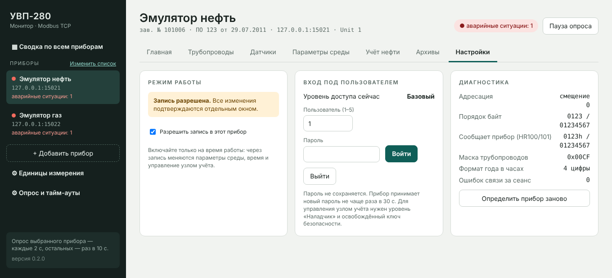
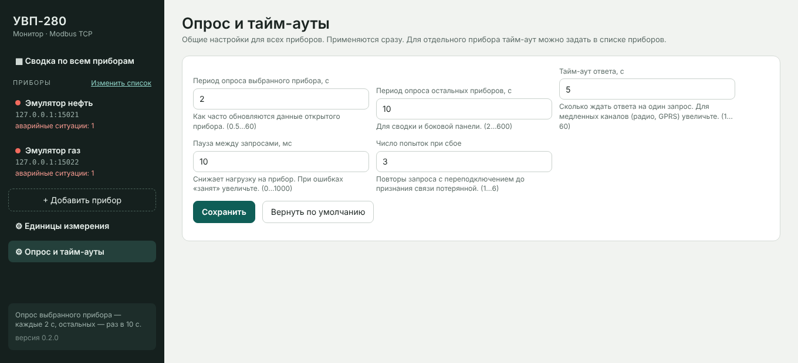

# УВП-280 Монитор

Программа для Windows: просмотр и настройка вычислителей **УВП-280.01** по **Modbus TCP**.
Не требует установки и дополнительных библиотек — один файл `UVP280Monitor.exe` (около 9 МБ).

## Быстрый старт
1. Скачайте `UVP280Monitor.exe` из раздела [**Releases → Последняя сборка**](https://github.com/Nikolay-Tob/uvp280-monitor/releases/tag/latest) и запустите.
   При первом запуске Windows может показать предупреждение SmartScreen (файл не подписан): «Подробнее» → «Выполнить в любом случае».
2. Откройте **«Изменить список» → добавьте прибор** (название, IP-адрес, порт 502, Unit ID) и нажмите «Проверить связь».
3. Выберите прибор в боковой панели или откройте «Сводку по всем приборам».

Окно открывается в Microsoft Edge в режиме приложения (в Windows 11 он уже есть; при его отсутствии используется Chrome или браузер по умолчанию).
Если закрыть окно, программа завершится примерно через 3 минуты. Список приборов и настройки хранятся в `%APPDATA%\UVP280Monitor\devices.json`.

## Возможности
**Просмотр**
- Сводка по всем приборам: связь, время и расхождение с ПК, ошибки, ключевые показания по трубопроводам.
- Главный экран: время прибора и расхождение с ПК, состояние NTP-клиента (блок скрывается, если в ПО прибора NTP нет), ошибки по трубопроводам, уровень доступа.
- Трубопроводы: давление, температура, расходы, накопленные итоги, прошлый час и сутки, настройки из карты параметров прибора.
- Датчики (логические входы): значения, единицы, источники, состояние; неописанные входы скрываются.
- Учёт нефти (только там, где он настроен в приборе): СИКН, БИК, измерительные линии, итоги часового/двухчасового, сменного и суточного периодов, КМХ, пробоотборник.
- Архивы: запрос отчёта за период (прошлый час, 2 часа, сутки, месяц или произвольный; срез), просмотр, копирование, CSV.
- Параметры среды (рег. 1000–1532): показываются только разделы, которые отдаёт прибор.

**Запись** — по умолчанию выключена для каждого прибора и включается на вкладке «Настройки» → «Разрешить запись». Каждое изменение подтверждается отдельным окном; записывать можно только в разрешённые регистры, после записи значение читается обратно.
- Параметры среды (без входа под пользователем).
- Время: подвод по ПК шагами до ±99 с, ручная поправка, адрес NTP-сервера, принудительная и автоматическая синхронизация. Часы прибора по Modbus только читаются, поэтому время меняется через NTP и поправку.
- Вход под пользователем 1–5 (пароль нигде не сохраняется).
- Управление узлом учёта нефти — нужен уровень «Наладчик» и освобождённый ключ безопасности: линии СИКН, КМХ (линии, параметры, запуск, прерывание), пробоотборник, коэффициенты плотности и К-факторы.

**Прочее**
- Единицы измерения переключаются (давление по умолчанию — МПа; также кПа, бар, кгс/см², мм рт.ст.; температура, расход, масса, объём, энергия).
- Опрос и тайм-ауты: период опроса выбранного и остальных приборов, тайм-аут ответа (общий и для отдельного прибора), пауза между запросами, число попыток.
- Порядок байт и адресация определяются автоматически по контрольным константам прибора (HR110/112/114); проверено на разных вариантах порядка байт.
- Список приборов можно экспортировать в файл и импортировать обратно.

**Чего программа не делает:** не меняет сетевые настройки прибора (IP, маска), не читает журнал нештатных ситуаций и операторские архивы, не хранит историю значений (только текущий сеанс).

## Скриншоты
Скриншоты сняты на эмуляторе прибора (`tools/uvp_emulator.py`), данные тестовые.

| | |
|---|---|
|  **Сводка по всем приборам** |  **Главная: время, NTP, состояние** |
|  **Трубопровод** |  **Датчики (логические входы)** |
|  **Учёт нефти** |  **Архивы** |
|  **Параметры среды** |  **Режим записи и вход** |
|  **Опрос и тайм-ауты** | |

## Разработка
Нужен только Python 3.8+, сторонние библиотеки не используются.
```
python -m uvpmon                      # запуск (параметры: --port, --no-window, --config файл.json)
python -m unittest discover -s tests  # проверки ядра на эмуляторе
```
Эмулятор прибора (для работы без реального прибора):
```
python tools/uvp_emulator.py --port 1502 --oil
```
Параметры: `--oil` (узел учёта нефти), `--swap` (порядок байт 2301/67452301), `--off -1` (нумерация адресов с 1), `--year2` (двузначный год),
`--no-ntp` (без NTP, как на ПО 217), `--inputs N` (число логических входов), `--drift N` (уход часов, с).
Вход в эмуляторе: пользователь 1, пароль 12345.

Структура: `uvpmon/` — ядро (Modbus, кодирование, сеанс прибора, сервер), `web/` — интерфейс, `tools/` — эмулятор и диагностика, `tests/` — проверки.
Сборка `.exe` выполняется автоматически в GitHub Actions (`.github/workflows/build.yml`): тесты → PyInstaller → проверка запуска → публикация в Releases.

`tools/uvp_probe.ps1` — диагностический скрипт PowerShell (только чтение) для проверки нового прибора:
```
powershell -ExecutionPolicy Bypass -File .\uvp_probe.ps1 -Ip 192.168.0.10
```
Результат сохраняется в текстовый файл. В нём есть IP-адрес и серийный номер прибора — не публикуйте его в открытом доступе.
